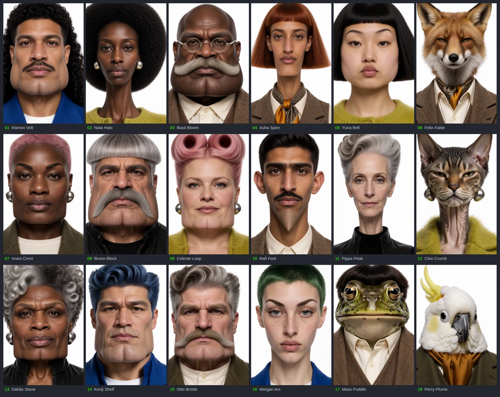

# OpenCast Studio

[](https://x.com/akatz_ai)
[](https://www.patreon.com/Akatz)
[](https://github.com/sponsors/akatz-ai)
[](https://ko-fi.com/akatz)

**OpenCast Studio** is an open-source app by Akatz Labs for creating character reference sheets and using those characters in video. This repository includes the frontend, local API, local GPU executor, workflows, and model manifests. It runs on your own workstation or a GPU workstation you connect over SSH. Account, billing, object-storage and cloud execution implementations belong in a separate repository.

Source: [akatz-labs/opencast-studio](https://github.com/akatz-labs/opencast-studio). Generation availability depends on the configured executor and its installed or deployed workflows.

[](docs/assets/opencast-mosaic.png)

Selected portraits generated with the [Krea 2 OpenCast LoRA](https://huggingface.co/akatz-ai/Krea-2-OpenCast-LoRA) at strength 1.0. Click the collage for the full-resolution image. Exact prompts, seeds, original images, and workflows are available in the [model’s example index](https://huggingface.co/akatz-ai/Krea-2-OpenCast-LoRA/blob/main/examples/README.md).

## Run the interface and API

Requirements: Node.js 22.18 or newer, npm, and `ffprobe` for reference-video validation.

Start with [the local setup guide](docs/LOCAL_SETUP.md) for GPU prerequisites, storage requirements, and gated model downloads. Coding agents should also read [AGENTS.md](AGENTS.md). Run `npm run doctor` for a read-only prerequisite check.

```sh
npm ci
npm run build
npm start
```

An interactive `npm start` opens the browser automatically. Set `OPENCAST_OPEN_BROWSER=0` for a headless server, or `1` to request opening explicitly. You can also open `http://localhost:8389` on that machine. State defaults to `~/.local/share/opencast`. The service binds to loopback. This starts the application, not a GPU runtime: generation remains unavailable until a workflow installation is configured. Authentication, billing and a cloud executor are separate integrations; this local entry point is not a public multiuser service.

Configuration is supplied through environment variables, never baked-in workstation paths. See [.env.example](.env.example); these variables must be exported by your shell or service manager. For a subdirectory deployment, set the same `OPENCAST_BASE_PATH` during both build and startup. For development use `npm run dev`, alongside the API.

## One-button setup

On startup, Studio checks model inventory and installed runtime probes. Incomplete installations open **Settings → Resources** automatically. Successfully configured installations open the normal Studio page, even when ComfyUI is sleeping. Dismissing Resources keeps it closed for the current page session; the next launch checks again. A transient outage of a previously completed worker does not trigger first-run setup.

Before installing, review **Model folder**. Enter an absolute directory on the executor and click **Use folder**, then **Install missing** (beside Refresh). Saving the path does not download files. Existing models must use the displayed ComfyUI subfolders and filenames. Setup checks and indexes the chosen folder through ComfyGit; it never moves or deletes models in the previous folder. This is a workspace-wide model folder, so other environments in that shared workspace use it too. Active work prevents changing it until the worker is idle. Runtime and application-data locations stay separate.

 New installations default to **This machine**, meaning the computer running the OpenCast backend. No resource configuration file is required. An existing private `OPENCAST_RESOURCE_CONFIG` still selects a remote executor and is never replaced with a local connection.

The installer:

1. Starts or reuses the shared local executor and pins its identity.
2. Installs the bundled, checksum-verified ComfyGit 0.7.1 toolchain in the shared layer's user data directory.
3. Materializes separate, content-addressed Krea and Pika environments from captured ComfyUI commits and dependency locks. Existing environments are preserved.
4. Installs published model dependencies into the executor's configured shared model store, reusing matching files and verifying downloaded bytes.
5. Retains setup receipts and progress so closing the browser does not stop installation.

Automatic runtime setup currently targets **Linux x64 with an NVIDIA GPU**. Node.js, Python 3 or uv, Git, a C++ compiler, FFmpeg and FFprobe are prerequisites. CUDA profiles are pinned separately: Krea uses cu130; Pika uses cu128. On other platforms, connect a compatible remote executor. Setup prepares dependencies without starting GPU sessions. The bundled worker connects character generation and both motion modes after installation. See [the motion workflow guide](docs/MOTION.md) for inputs, retained outputs, and runtime requirements.

The [OpenCast character LoRA](https://huggingface.co/akatz-ai/Krea-2-OpenCast-LoRA), Pika/H3 dependencies, and all four FLUX3 anchor dependencies are pinned in [resources/models.json](resources/models.json). Public files install through **Install missing**. The three gated FLUX3 weights require accepting their Hugging Face conditions and placing the pinned files in the displayed model folders; **Scan models** then discovers them. The motion pipeline does not require SAM or Depth Anything.

The shared layer chooses the standard workspace and model directory. Existing shared configuration is respected. Private overrides may supply `workspace` or `modelsRoot`, but changing an existing workspace's model store is never implicit. Both runtime recipes, source locks and model checksums are bundled in the repository.

A remote configuration uses:

```json
{
  "target": {"kind": "ssh", "host": "user@workstation", "port": 8841},
  "executorId": "REPLACE_WITH_YOUR_EXECUTOR_ID",
  "name": "My GPU worker"
}
```

The backend owns this connection. Runtime installation requires the shared worker's `cpu-only-install-v1` capability, which prevents installation from disturbing unrelated warm GPU sessions. An older or offline remote worker is preserved and reports the needed update. New local workers include this capability.

General appearance settings are browser-local. Resources also provides individual model installs, scans, source URLs and checksum details. About contains app information and the planned public GitHub repository link. Model licenses remain those of their publishers.

## Workflow integration

[docs/API.md](docs/API.md) defines uploads, stable asset IDs, jobs, progress, output access, ownership and shared-runner configuration. Set `OPENCAST_EXECUTOR_CONFIG` to select reviewed installations and trusted recipe modules. Recipes compile UI inputs into the installation's contract; frontend code stays unchanged when the backend executor changes.

`server/start.mjs` is the portable shared-runner entry point. `server/index.mjs` is the compatibility entry point for existing direct ComfyUI installations. It accepts `OPENCAST_COMFY` and an optional trusted `OPENCAST_DEPLOYMENT_MODULE` exporting storage hooks and a swap-worker adapter. No workstation, GPU UUID, SSH host or managed-storage service is selected implicitly. Private legacy worker launchers are deliberately excluded from this source distribution.

Historical `cast-*` storage keys and drag formats remain compatible with existing browser drafts and generation history. Display branding is OpenCast Studio.

## Development and verification

```sh
npm test
npm run build
npm run audit:release
npm run package:source
```

Unit/integration tests cover API contracts, media validation, ownership, recovery, workflow prompts, resource management and portable packaging. Browser checks in `tests/` accept configurable origins and browser paths. GPU-generating checks are explicitly separate from UI fixture tests.

The source archive includes source, workflows, resource identities and UI assets. It excludes private configuration, state, hosting metadata, runtime caches, builds and deployment-specific launchers. Third-party transport attribution is retained in [THIRD_PARTY_NOTICES.md](THIRD_PARTY_NOTICES.md).

## Project naming

The product is **OpenCast Studio**, the package and repository name is `opencast-studio`, and the GitHub namespace is `akatz-labs`. Existing `OPENCAST_*` configuration variables, the `opencast` executor app ID, browser preferences and data directories stay stable for compatibility. Optional source bundles are created in `artifacts/opencast-studio-source.zip` and are not committed.

## 💜 Support Akatz Labs

I build and release AI tools, models, LoRAs, and workflows so others can experiment, create, and build upon them.

If OpenCast Studio has been useful to you, consider helping fund the next experiment!

Your support goes toward GPU compute, software development, and future open-source releases.

**Support the lab:** [GitHub Sponsors](https://github.com/sponsors/akatz-ai) · [Patreon](https://www.patreon.com/Akatz) · [Ko-fi](https://ko-fi.com/akatz)

Thanks for helping keep independent creative AI development moving! 💜

[Explore Akatz Labs →](https://akatz.ai)
